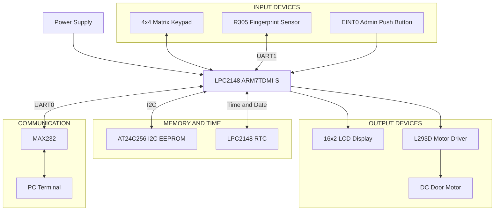

<div align="center">

# 🔐 SecureGate Pro
## Intelligent Multi-Level Biometric Access Control & Intrusion Prevention System

**An embedded system for automated, secure, and intelligent biometric access management.**

[](https://www.nxp.com)
[](https://en.wikipedia.org/wiki/Embedded_C)
[](https://www.keil.com/)
[]()
[]()

</div>

---

## 📌 Overview

The **SecureGate Pro – Intelligent Multi-Level Biometric Access Control and Intrusion Prevention System** is a real-time embedded application designed to provide secure and automated access control.

Built on the **NXP LPC2148 ARM7TDMI-S microcontroller**, the system integrates an R305 fingerprint sensor, 4×4 matrix keypad, 16×2 LCD, AT24C256 I2C EEPROM, RTC, MAX232 and L293D motor driver.

The system implements three levels of authentication:

1. User ID Verification
2. Password Verification
3. Fingerprint Authentication

Access is granted only when all three authentication stages are successful. After successful verification, the LPC2148 activates the L293D motor driver to operate the DC motor and control the door.

The system also provides administrator access, user management, account lockout, intrusion prevention and timestamped event logging.

> 💡 This system improves security by combining password-based authentication, biometric verification and automated door access control.

---

## ✨ Features

| Feature | Description |
|---|---|
| 🔐 **Three-Level Authentication** | User ID → Password → Fingerprint |
| 👆 **Fingerprint Recognition** | R305 biometric fingerprint matching |
| 🔢 **Password Protection** | Individual user password verification |
| 💾 **EEPROM Storage** | Stores up to 8 user records and administrator PIN |
| 🚪 **Automatic Door Control** | DC motor controlled through L293D |
| 🔒 **Account Lockout** | Locks account after 3 incorrect passwords or fingerprint mismatches |
| 🚨 **System Lockdown** | 30-second lockdown after 3 invalid IDs or incorrect administrator PIN attempts |
| 👨‍💻 **Admin Panel** | Add/delete users, manage passwords and fingerprints |
| ⏰ **RTC Management** | Real-time date and time tracking |
| 📊 **Event Logging** | Records successful and unsuccessful access attempts |
| 🖥️ **16×2 LCD Display** | Displays authentication status and system messages |
| ⌨️ **4×4 Keypad** | User ID, password and administrator input |
| 🔌 **UART Communication** | Fingerprint communication and PC event logging |
| 🔗 **I2C Communication** | EEPROM read/write operations |
| 🛡️ **I2C Bus Recovery** | Handles EEPROM communication timeouts without freezing the system |

---

## 🚦 Authentication and Security Logic

```text
Authentication Stage       System Operation
─────────────────────      ─────────────────────────────
Level 1                    Enter User ID
                           ↓
Level 2                    Verify Password
                           ↓
Level 3                    Fingerprint Matching
                           ↓
All Successful             Access Granted
                           ↓
                           Door Opens

Incorrect Password         Attempt Counter Increases
3 Incorrect Passwords      User Account Locked

Fingerprint Mismatch       Attempt Counter Increases
3 Mismatches               User Account Locked

3 Invalid User IDs         30-Second System Lockdown
3 Wrong Admin PINs         30-Second System Lockdown
```

---

## 🏗️ System Architecture

### Block Diagram



**Block overview:**

- **Main Controller (`LPC2148`)** — Processes authentication, controls peripherals and manages the complete security system.
- **Fingerprint Sensor (`R305`)** — Captures and matches registered fingerprints.
- **Keypad** — Accepts user ID, password and administrator inputs.
- **EEPROM (`AT24C256`)** — Stores user records and administrator PIN using I2C.
- **LCD** — Displays instructions, authentication status and system messages.
- **Motor Driver (`L293D`)** — Controls DC motor direction and door operation.
- **RTC** — Maintains date and time for event logging.
- **UART0 + MAX232** — Sends timestamped event logs to the PC terminal.
- **UART1** — Provides serial communication with the R305 fingerprint sensor.
- **EINT0** — Provides administrator menu access through an external push button.

---

## 🔌 Hardware Components

| # | Component | Part / Spec | Role |
|---|---|---|---|
| 1 | Microcontroller | NXP LPC2148 (ARM7TDMI-S) | Core processing |
| 2 | Fingerprint Sensor | R305 | Biometric authentication |
| 3 | EEPROM | AT24C256 (I2C) | User data storage |
| 4 | Display | 16×2 Character LCD | Authentication messages |
| 5 | Keypad | 4×4 Matrix Keypad | User input and navigation |
| 6 | Motor Driver | L293D | DC motor control |
| 7 | DC Motor | DC Geared Motor | Door mechanism |
| 8 | RTC | LPC2148 RTC | Real-time clock |
| 9 | MAX232 | RS232 Converter | PC serial communication |
| 10 | Push Button | EINT0 | Administrator access |
| 11 | Crystal | 12 MHz | Controller clock source |

---

## 📍 Pin Configuration

### GPIO — Port 0

| Pin | Label | Function |
|---|---|---|
| P0.0 | TXD0 | UART0 PC transmission |
| P0.1 | RXD0 | UART0 PC reception |
| P0.2 | SCL | I2C EEPROM clock |
| P0.3 | SDA | I2C EEPROM data |
| P0.4 | IN1 | L293D motor direction control |
| P0.5 | IN2 | L293D motor direction control |
| P0.6 | DOOR_SWITCH | Door-closed switch input (optional) |
| P0.7 | MOTOR_ENABLE | L293D motor enable |
| P0.8 | TXD1 | UART1 fingerprint transmission |
| P0.9 | RXD1 | UART1 fingerprint reception |
| P0.12 | LCD_RS | LCD register select |
| P0.13 | LCD_EN | LCD enable |
| P0.16 | EINT0 | Administrator button |

### GPIO — Port 1

| Pin | Label | Function |
|---|---|---|
| P1.16 | ROW0 | Keypad row 1 |
| P1.17 | ROW1 | Keypad row 2 |
| P1.18 | ROW2 | Keypad row 3 |
| P1.19 | ROW3 | Keypad row 4 |
| P1.20 | COL0 | Keypad column 1 |
| P1.21 | COL1 | Keypad column 2 |
| P1.22 | COL2 | Keypad column 3 |
| P1.23 | COL3 | Keypad column 4 |
| P1.24–P1.31 | LCD_DATA | LCD D0–D7 data bus |

### Special Function Pins

| Pin | Function |
|---|---|
| UART0 TXD0/RXD0 | PC communication through MAX232 |
| UART1 TXD1/RXD1 | R305 fingerprint communication |
| I2C0 SCL | AT24C256 clock |
| I2C0 SDA | AT24C256 data |
| EINT0 | Administrator menu trigger |
| P0.4/P0.5 | Motor direction control |
| P0.7 | Motor enable |

---

## 🖥️ Virtual Simulation Architecture in Proteus

The Proteus simulation represents the interfacing of the LPC2148 with the input, output, memory and communication peripherals.

<!-- Add your actual Proteus circuit screenshot below -->

<div align="center">


</div>

---

## 📁 Project Structure

The project follows a modular embedded firmware architecture. Each peripheral driver and application-level functionality is maintained in separate source and header files for better code organization, debugging and maintenance.

```text
SecureGate-Pro/
│
├── Inc/                          ← Header files
│
├── Src/                          ← Source files
│   ├── main.c                    ← Main authentication sequence
│   ├── admin.c                   ← Administrator operations
│   ├── r305.c                    ← Fingerprint sensor driver
│   ├── eeprom.c                  ← EEPROM read/write operations
│   ├── i2c.c                     ← I2C communication
│   ├── lcd.c                     ← LCD driver
│   ├── keypad.c                  ← Keypad scanning
│   ├── motor.c                   ← DC motor control
│   ├── rtc.c                     ← RTC configuration
│   ├── uart0.c                   ← PC serial communication
│   ├── uart1.c                   ← Fingerprint communication
│   ├── interrupt.c               ← External interrupt handling
│   ├── delay.c                   ← Delay functions
│   └── board_config.h            ← Hardware pin configuration
│
├── firmware/
│   └── SecureGate_Pro.hex        ← Pre-built firmware
│
├── Startup.s                     ← ARM startup code
├── SecureGate_Pro.uvproj         ← Keil project file
├── SecureGate_Pro.uvopt          ← Keil target options
├── LICENSE
└── README.md
```

### Software Modules

| Module | Responsibility |
|---|---|
| `main.c` | Main program and ID → password → fingerprint authentication |
| `admin.c` | Admin menu, user management and event logs |
| `r305.c` | Fingerprint sensor communication protocol |
| `eeprom.c` | EEPROM read/write operations |
| `i2c.c` | I2C communication and bus recovery |
| `lcd.c` | LCD initialization and display |
| `keypad.c` | Keypad scanning and input processing |
| `motor.c` | Door opening, closing and denial control |
| `rtc.c` | Real-time clock configuration |
| `uart0.c` | PC terminal communication |
| `uart1.c` | Fingerprint serial communication |
| `interrupt.c` | External interrupt handling |
| `delay.c` | Delay generation |

---

## ⚙️ How It Works

### 1️⃣ Boot & Initialization

```text
Power ON
    ↓
Initialize LPC2148 GPIO
    ↓
Initialize LCD and Keypad
    ↓
Initialize UART0 and UART1
    ↓
Initialize I2C and EEPROM
    ↓
Initialize RTC
    ↓
Initialize R305 Fingerprint Sensor
    ↓
Display SYSTEM READY
    ↓
Enter Main Authentication Loop
```

### 2️⃣ Main Authentication Loop (`main.c`)

- **Step 1:** User enters a unique ID through the 4×4 keypad.
- **Step 2:** System checks whether the entered ID exists in EEPROM.
- **Step 3:** User enters the password.
- **Step 4:** Controller verifies the password against the stored user record.
- **Step 5:** User places a finger on the R305 sensor.
- **Step 6:** R305 searches for the registered fingerprint.
- **Step 7:** Controller receives the matching result.
- **Step 8:** If all three stages succeed, the motor driver activates.
- **Step 9:** Door opens, holds for the configured time and closes.

### 3️⃣ Administrator Access (EINT0 Button)

```text
Press EINT0 Push Button
          ↓
Enter Administrator PIN
          ↓
Verify Administrator PIN
          ↓
Open Administrator Menu
          ↓
Manage Users, Passwords and Fingerprints
          ↓
View Event Logs / Set RTC Clock
          ↓
Exit Administrator Mode
```

> ⚠️ Administrator access is protected by a PIN. Repeated incorrect administrator PIN attempts trigger a 30-second system lockdown.

### 4️⃣ Door Access Lifecycle

```text
Enter User ID
      ↓
Verify User ID
      ↓
Enter Password
      ↓
Verify Password
      ↓
Fingerprint Verification
      ↓
Authentication Successful
      ↓
Activate L293D Motor Driver
      ↓
DC Motor Opens Door
      ↓
Door Holds for Configured Time
      ↓
DC Motor Closes Door
      ↓
Return to Main Authentication Loop
```

---

## 🔐 Three-Level Authentication System

### Level 1 – User ID Verification

The user enters a unique identification number through the keypad.

- Maximum 8 registered users.
- User ID supports up to 6 digits.
- Controller checks the entered ID against EEPROM records.
- Invalid IDs increase the failure counter.

### Level 2 – Password Verification

After successful ID verification, the user enters a password.

- Password length: 4–8 digits.
- Password information is stored in AT24C256 EEPROM.
- Incorrect passwords increase the attempt counter.
- Three incorrect attempts lock the user account.

### Level 3 – Fingerprint Authentication

The R305 fingerprint sensor verifies the user's biometric identity.

- Fingerprint enrolment through administrator mode.
- Fingerprint matching through UART.
- Three fingerprint mismatches lock the user account.
- Fingerprint templates are stored inside the R305 module.

Access is granted only after all three authentication levels succeed.

---

## 💾 EEPROM Data Storage

### AT24C256 I2C EEPROM

The external EEPROM provides non-volatile storage for user records and administrator credentials.

| Parameter | Specification |
|---|---|
| IC | AT24C256 |
| Interface | I2C |
| Memory Capacity | 256 Kbit |
| Total Storage | 32 KB |
| 7-bit Base Address | 0x50 |
| Communication Pins | SCL and SDA |
| Storage Type | Non-volatile memory |

### Stored Information

- User IDs
- User passwords
- Administrator PIN
- User account information
- Authentication-related records, as configured in firmware

**Fingerprint Storage:** Fingerprint templates are stored in the internal flash memory of the R305 fingerprint module, not in the AT24C256 EEPROM.

### Why I2C EEPROM?

- Requires only two communication lines.
- Supports serial data transfer.
- Reduces GPIO pin usage.
- Provides non-volatile data storage.
- Suitable for storing user credentials.

---

## 👆 Fingerprint Sensor – R305

The R305 fingerprint module communicates with LPC2148 through UART.

### Working Process

1. User places a finger on the fingerprint sensor.
2. Sensor captures the fingerprint image.
3. Fingerprint image is converted into a template.
4. The sensor searches for a matching enrolled template.
5. Matching information is sent to LPC2148.
6. Controller decides whether authentication is successful.

### Communication

| Parameter | Details |
|---|---|
| Module | R305 |
| Interface | UART |
| Default Baud Rate | 57600 (configuration-dependent) |
| TX | Sensor transmission |
| RX | Sensor reception |
| Storage | Internal fingerprint flash |

The firmware supports automatic sensor detection on UART0/UART1 using the configured baud rates.

---

## 🚪 Motor Control – L293D

The L293D motor driver controls the DC motor used for door operation.

### Motor Connections

| L293D Pin | Connection |
|---|---|
| IN1 | LPC2148 P0.4 |
| IN2 | LPC2148 P0.5 |
| Enable | LPC2148 P0.7 |
| OUT1 | DC Motor Terminal 1 |
| OUT2 | DC Motor Terminal 2 |
| VCC1 | Logic Supply |
| VCC2 | Motor Supply |
| GND | Common Ground |

### Motor Operation

| Condition | Motor Action |
|---|---|
| Authentication Successful | Door Opens |
| Door Hold Time Completed | Door Closes |
| Authentication Failed | Door Remains Locked |

The motor operates only after successful three-level authentication.

---

## 📡 UART Communication

The project uses two UART communication peripherals.

| UART | Connection | Baud Rate | Purpose |
|---|---|---|---|
| UART0 | LPC2148 ↔ MAX232 ↔ PC | 9600 | Event logging |
| UART1 | LPC2148 ↔ R305 | 57600 default | Fingerprint communication |

### PC Terminal Event Logging

The system sends timestamped access information to a PC terminal.

Example:

```text
LOG 012: [15/10/2026 10:42:07]
USER 243562 - ACCESS GRANTED

LOG 013: [15/10/2026 10:45:12]
USER 123456 - ACCESS DENIED
```

Communication configuration:

- Baud rate: 9600
- Data bits: 8
- Parity: None
- Stop bits: 1

---

## 🔗 I2C Communication

I2C is used to communicate between LPC2148 and AT24C256 EEPROM.

### I2C Pins

| LPC2148 Pin | Function |
|---|---|
| P0.2 | SCL – Serial Clock |
| P0.3 | SDA – Serial Data |

### I2C Working

1. LPC2148 generates the START condition.
2. Controller sends the EEPROM address.
3. EEPROM acknowledges the address.
4. Controller sends the memory address.
5. Data is transferred through SDA.
6. Controller generates the STOP condition.

The firmware also implements I2C timeout and bus-recovery handling to prevent the controller from freezing when EEPROM communication fails.

---

## ⏰ Real-Time Clock (RTC)

The LPC2148 RTC maintains the current date and time.

RTC information is used for:

- Recording access timestamps.
- Maintaining event history.
- Tracking successful access attempts.
- Tracking unsuccessful access attempts.
- Displaying the current system time.

The clock can be configured through the administrator menu.

---

## 👨‍💻 Administrator Menu

The administrator has access to user management, fingerprint management and system configuration.

| Key | Function |
|---|---|
| 1 | Edit Password |
| 2 | Fingerprint Enrolment / Deletion |
| 3 | Add User |
| 4 | Delete User |
| 5 | Exit |
| A | Unlock User |
| B | View Last 25 Log Lines |
| C | Set RTC Clock |

### Keypad Operation

| Key | Function |
|---|---|
| 0–9 | Numeric input |
| # | Enter / Confirm |
| * | Backspace |

### User Management

- Add new users.
- Delete existing users.
- Edit user passwords.
- Enrol fingerprints.
- Delete individual fingerprints.
- Delete all enrolled fingerprints.
- Unlock locked accounts.

---

## 🛠️ Development Environment

| Tool | Details |
|---|---|
| **IDE** | Keil µVision 4/5 (ARM-MDK) |
| **Compiler** | Keil ARM C Compiler |
| **Target MCU** | NXP LPC2148 – ARM7TDMI-S |
| **Crystal Frequency** | 12 MHz |
| **Language** | Embedded C |
| **Communication** | UART, I2C |
| **Debugger** | Keil Debugger |
| **Flash Tool** | Flash Magic (UART ISP) |
| **Simulation** | Proteus (where supported) |

---

## 🚀 Getting Started

### Prerequisites

- Keil µVision IDE installed.
- LPC2148 development board.
- R305 fingerprint sensor.
- AT24C256 EEPROM.
- 16×2 LCD.
- 4×4 matrix keypad.
- L293D motor driver.
- DC geared motor.
- MAX232 module.
- Flash Magic.

### Steps

```bash
# 1. Clone the repository

git clone https://github.com/omkarsabale27/SecureGate-Pro-Intelligent-Multi-Level-Biometric-Access-Control-And-Intrusion-Prevention-System.git

# 2. Open the project in Keil µVision

# Open SecureGate_Pro.uvproj

# 3. Check source and header files

# 4. Configure the target microcontroller
# Device: LPC2148

# 5. Build the project
# Project → Build Target (F7)

# 6. Generate HEX file
# Configure Create HEX File in Keil

# 7. Flash LPC2148
# Use Flash Magic or another supported ISP tool
```

> ⚠️ **Common pitfall:** If you encounter linker errors such as `Undefined symbol`, ensure that the corresponding source `.c` file has been added to the Keil project. A function declaration in a header file is not sufficient; its implementation must also be compiled and linked.

---

## 🔒 Security Information

- Three-factor authentication.
- User account lockout.
- Administrator PIN protection.
- Fingerprint enrolment and deletion.
- Password management.
- 30-second system lockdown.
- Timestamped access records.
- Automatic door control.

**Default Administrator PIN:** `1234`

Change the factory administrator PIN before real-world deployment.

---

## 🎯 Applications

- Office access control.
- Industrial security systems.
- Laboratory security.
- Restricted-area access management.
- Educational institutions.
- Smart door-lock systems.
- Residential security systems.

---

## 🔮 Future Improvements

- IoT-based remote monitoring.
- GSM-based security notifications.
- Cloud-based access logs.
- Mobile application integration.
- Advanced intrusion detection.
- Additional biometric authentication.
- Remote door access management.

---

## 🏁 Conclusion

SecureGate Pro demonstrates the practical implementation of an intelligent biometric access control system using the LPC2148 ARM7 microcontroller.

By integrating three-level authentication, fingerprint recognition, external EEPROM storage, UART and I2C communication, RTC and automated motor control, the system provides a structured approach to secure access management.

This project helped develop practical knowledge of Embedded C programming, ARM7 architecture, peripheral interfacing, communication protocols, EEPROM operations, UART communication, I2C communication, interrupt handling and real-time embedded system development.

---

<div align="center">

**Built with ❤️ on ARM7 | LPC2148 | Embedded C**

### 🔐 SecureGate Pro – Smart Security, Intelligent Access.

</div>
